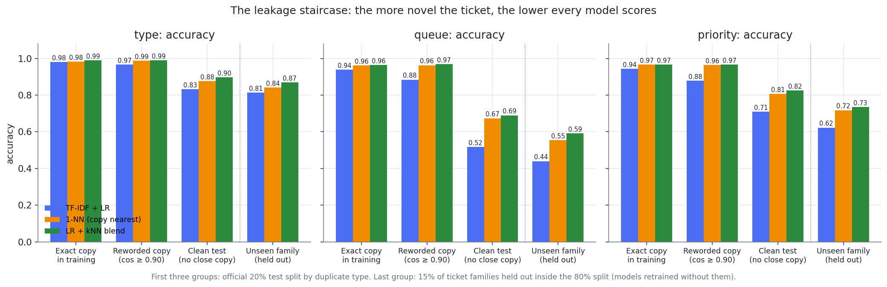
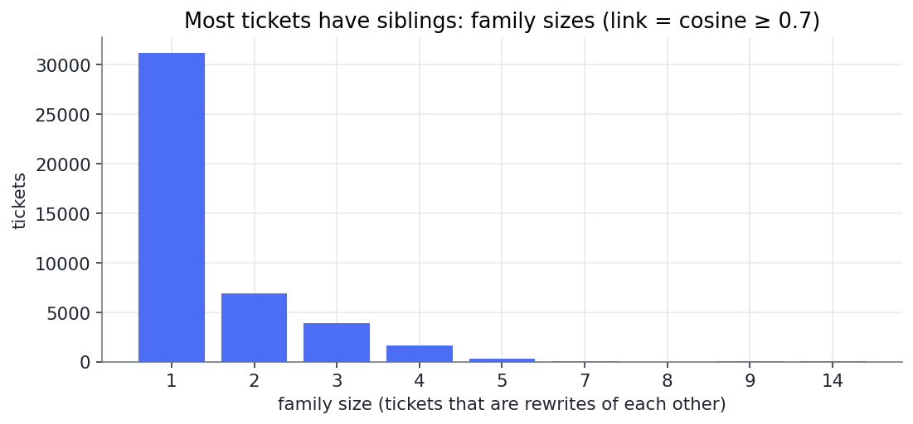
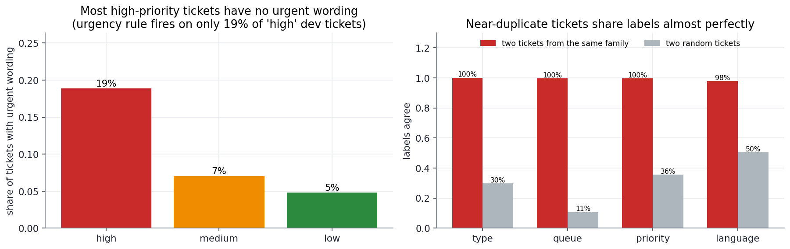
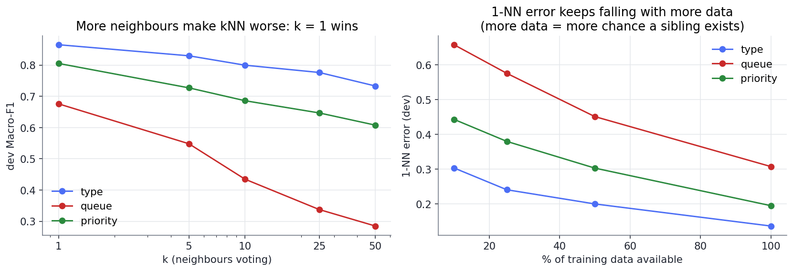
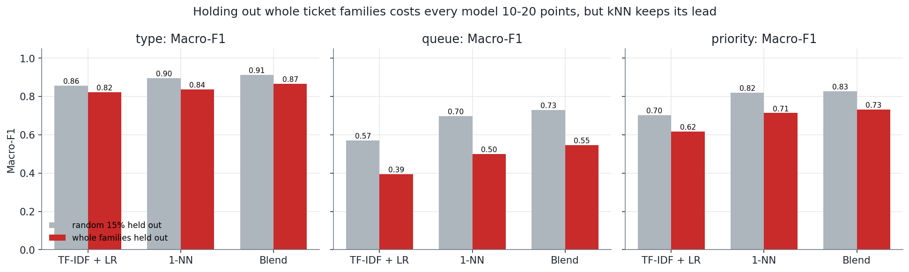
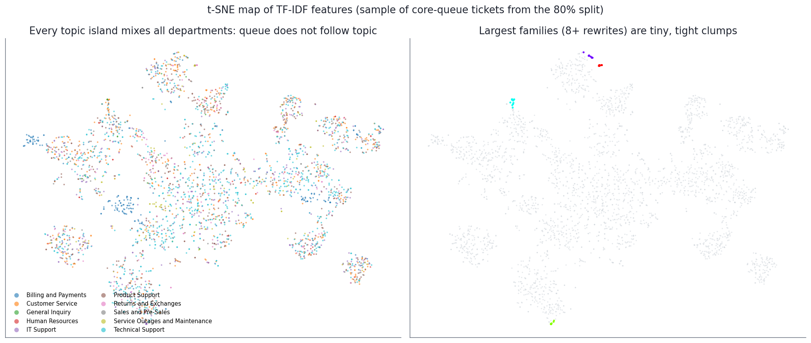

# What we found in the data, and why we built two systems

All numbers come from `findings/out/findings.json`, `triage/reports/*.json` and `dataset/data/split_meta.json`. Test-set numbers come from a single run of `eval.py` / `knn_eval.py`. The family experiments use only the 80% training split. Reproduce with `python3 findings/analyze.py && python3 findings/figures.py`; the analysis takes about 4 minutes on 32 cores.

## 1. The official split leaks
- **22% of test tickets are exact copies of training tickets.** They come from two source CSVs that overlap; no single CSV contains duplicates.
- **About 900 more test tickets are reworded copies,** and 349 repeat earlier test rows.
- **Copies share labels 99.6–99.8% of the time.** Any score on the full official test set is inflated.

The more novel the ticket, the lower **every** model scores. On the queue head (department), accuracy falls from 0.94–0.97 on exact copies to 0.52–0.69 on our clean test set, and to 0.44–0.59 on whole ticket families held out.

## 2. Near-duplicate families: real, but concentrated
- We linked tickets at combined TF-IDF cosine ≥ 0.70 using a 10-nearest-neighbour graph and its connected components. **About 29% of training tickets have at least one sibling;** 71% are singletons. Families are small, mostly pairs.
- **Inside a family, labels agree almost perfectly:** type 100%, queue 99.6%, priority 99.6%. For random pairs the figures are 30%, 11% and 36%.
- **Only 2.9% of families mix English and German,** so cross-language copies are rare.

## 3. kNN is the dominant strategy, and not only through memory
- **Copying the single most similar ticket (1-NN) beats TF-IDF + logistic regression.** More voting neighbours make it worse (k = 1 wins), and its error keeps falling as data grows.

- **We tested whether kNN wins only by remembering siblings.** We held out 15% of *whole families* and compared against a random 15%, retraining every model each time.

| Macro-F1 (random split → whole families held out) | TF-IDF + LR | 1-NN | LR + kNN blend |
|---|---|---|---|
| type | 0.86 → 0.82 | 0.90 → 0.84 | 0.91 → 0.87 |
| queue | 0.57 → 0.39 | 0.70 → 0.50 | 0.73 → 0.55 |
| priority | 0.70 → 0.62 | 0.82 → 0.71 | 0.83 → 0.73 |

**Conclusion.** Families inflate every model by 10–20 points. But kNN keeps a lead of about 0.10 even on families it has never seen. Our first hypothesis, "kNN only wins by memorizing", is **partly wrong**. Local similarity genuinely suits this data better than one linear boundary. The likely reason is the next finding.

## 4. Labels follow templates, not topic or urgency
- **Queue does not follow topic.** In the t-SNE map, every topic island contains every department. A linear model cannot draw clean department boundaries, while a nearest-neighbour vote can follow the local labelling pattern.

- **Priority only loosely follows urgency.** Urgent wording ("outage", "all users", "dringend"…) is about 4× more common in "high" tickets (19% vs 5% in "low"), but **81% of high-priority tickets contain none.** The example family below is about an outage across several products and is labelled *medium*. Our classifier also missed the brief's own hospital-VPN outage example, which is why the gate has explicit urgency rules.
- **Language labels are noisy.** 13% of tickets labelled `de` (3,275 of 24,428) are written in English. We detect the language from the text, as the brief requires, rather than trusting the label.

**Example family** (rewrites of one seed ticket, all type Incident, queue *Service Outages and Maintenance*, priority *medium*):

| ticket | language label | subject | body (start) |
|---|---|---|---|
| TKT-04075 | de (text is English) | Support for Multiple Product Downtime | Experienced unexpected downtimes with several products, including Twitch Studio Beta and MATLAB… |
| TKT-06364 | de (text is English) | Support for Unexpected Operating Hours in Multiple | Experienced unexpected operating hours for several products, including Twitch Studio Beta and MATLAB… |
| TKT-07113 | en | Assistance with Downtime Problems | went through unforeseen downtime with various products, such as Twitch Studio Beta and MATLAB… |
| TKT-35599 | en | Support Downtime Concerns | Encountered unexpected downtime on various products, such as Twitch Studio Beta and MATLAB… |
| TKT-48230 | en | Assistance with Downtime Concerns | Encountered unexpected downtime across various products, such as Twitch Studio Beta and MATLAB… |

## 5. What we ship, and why there are two systems

| | Benchmark mode | Production mode |
|---|---|---|
| Classifier | LR + kNN blend | Same blend (kNN still wins on unseen families) |
| Clean-test Macro-F1 (type / queue / priority) | 0.90 / 0.68 / 0.83 | same |
| Expected on genuinely new tickets | about 0.87 / 0.55 / 0.73 (family-held-out estimate) | same, plus the safety layers below |
| Escalation | classifier rules | + explicit urgency rules (EN/DE, built), + live outage burst banner (in progress), + low-similarity / unsupported-request rules (planned) |
| Replies | — | grounded only in retrieved precedents, with one cited ticket ID per sentence and a number/commitment guard (planned by the team) |

**Talking points:**
1. We found and removed the leakage, and report clean, full and family-held-out numbers side by side.
2. kNN wins on this dataset, and we tested *why*. It isn't only memorization, but the honest expectation on new tickets is the family-held-out number.
3. Labels don't encode urgency well, so safety can't rest on the classifier. Explicit rules and the burst detector catch what the labels miss.

## Caveats
- The families threshold (0.70 combined cosine) is a choice. Higher thresholds give fewer and smaller families (see `family_thresholds` in `findings.json`).
- The family-held-out split is drawn inside the 80% training split, not from the official test set. Its TF-IDF vocabulary was refit on each training split.
- The t-SNE map is illustrative only. The quantitative claims rest on the tables above.
